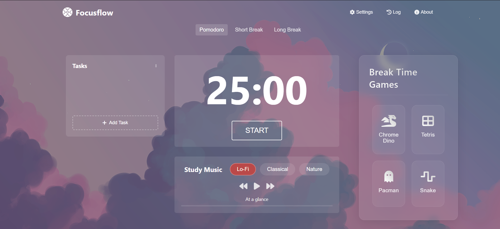

# FocusFlow

**A Pomodoro timer with a task list, study music, ambient sounds and break-time games, all in a single web page.**

FocusFlow helps you work in focused sessions: pick a task, start the timer, and take a break when the alarm rings. It is built with plain HTML, CSS and JavaScript, so there is nothing to install and no build step.

<p align="center">
  
</p>

> A group project by a team of four students. See [Team](#team).

---

## Features

### Pomodoro timer
- Three modes: **Pomodoro** (25 min), **Short Break** (5 min) and **Long Break** (15 min).
- Durations are adjustable in Settings (entered in seconds).
- The background changes with the timer mode, using a set of sky images.
- When a session ends, the alarm plays and the timer resets to the current mode's duration.

### Task list
- Add tasks with an estimated number of Pomodoros and optional notes.
- Edit, delete, mark complete, and **drag and drop** to reorder.
- Completed Pomodoros count towards the selected task.
- Tasks are saved in your browser (`localStorage`), so they are still there after a refresh.

### Sound
- **Alarms:** Kitchen, Bell or Digital, with volume and a repeat count (1 to 10 times).
- **Background sounds while focusing:** soft ticking, mechanical ticking, white noise or brown noise, with their own volume.
- All sound settings are saved in your browser.

### Study music player
- Three genres: **Lo-Fi**, **Classical** and **Nature**.
- Play, pause, next and previous, with a track name and progress bar.
- The music files are not included in this repository. See [Music files](#music-files).

### Break-time games
- Buttons for **Chrome Dino**, **Tetris**, **Pacman** and **Snake**.
- Each opens a free online version in a popup window. The games are third-party sites, not part of this project.

### Activity log
- Records timer starts, stops and completed sessions during your current visit.
- The **Log** button downloads it as a text file (`focusflow-log-YYYY-MM-DD.txt`).
- The log is kept in memory only, so it is cleared when you close or refresh the page. Download it first if you want to keep it.

## Getting started

You need a modern browser (Chrome, Edge, Firefox or Safari). There are no dependencies to install.

**Option 1: open the file**

```bash
git clone https://github.com/malsaaaa/FocusFlow.git
cd FocusFlow
```

Then open `index.html` in your browser.

**Option 2: serve it locally** (recommended, because some browsers restrict audio and storage on `file://` pages)

```bash
python -m http.server 8000
```

Then open http://localhost:8000.

## How to use

1. Click **Add Task**, name it, and set how many Pomodoros you expect it to take.
2. Select the task you want to work on.
3. Press **START** and focus for 25 minutes.
4. When the alarm rings, switch to **Short Break** and relax, or play a game.
5. Repeat, and take a **Long Break** after several Pomodoros.
6. Open **Settings** to change durations, the alarm and the background sound, then press **Save**.

## Project structure

```
FocusFlow/
├── index.html       # Page structure, settings and modals
├── script.js        # Timer, tasks, sounds, music player, games and log
├── styles.css       # Styling and animations
├── images/          # Logo and sky backgrounds
└── sounds/          # Alarms and background sounds (mp3)
```

Default timer values are at the top of `script.js` and can be changed there:

```javascript
let POMODORO_TIME = parseInt(localStorage.getItem('pomodoroTime') || '1500');    // 25 minutes
let SHORT_BREAK_TIME = parseInt(localStorage.getItem('shortBreakTime') || '300'); // 5 minutes
let LONG_BREAK_TIME = parseInt(localStorage.getItem('longBreakTime') || '900');   // 15 minutes
```

## Music files

The player expects these files in a `music/` folder:

```
music/
├── lofi/       track1.mp3 ... track5.mp3
├── classical/  track1.mp3 ... track3.mp3
└── nature/     track1.mp3 ... track3.mp3
```

They are not in the repository, so the music player will not play until you add your own tracks with those names. Use music you have the right to use, such as royalty-free or Creative Commons tracks. Track names shown in the player are set in the `playlists` object in `script.js`.

## Tech stack

- HTML5, CSS3 and vanilla JavaScript (no frameworks)
- HTML `<audio>` elements for alarms and background sounds
- `localStorage` for tasks and settings
- [Font Awesome](https://fontawesome.com/) 6 icons, loaded from a CDN

## Limitations

- Your tasks and settings live in your own browser. They do not sync between devices.
- The timer runs in the page, so it can slow down or pause if the browser throttles a background tab. Keep the tab visible for accurate timing.
- The break games are external websites and need an internet connection.
- The music tracks are not included (see above).

## Team

Group project by:

| Name | Role |
| :--- | :--- |
| Danial Hakim bin Mohd Arif | Lead Developer |
| Syed Danish Aslam Bin Syed Mohd Mahzan | Frontend Developer |
| Muhammad Danial Danny Bin Mazlan | UI/UX Developer |
| Asfa Danish Bin Hezri | Backend Integration |

## License

Copyright (c) 2025 the project team. All rights reserved.

This repository is public for viewing and portfolio purposes. No license is granted to copy, modify, distribute or use the code without the team's written permission. The Pomodoro Technique is a trademark of Francesco Cirillo, and this project is not affiliated with it.
